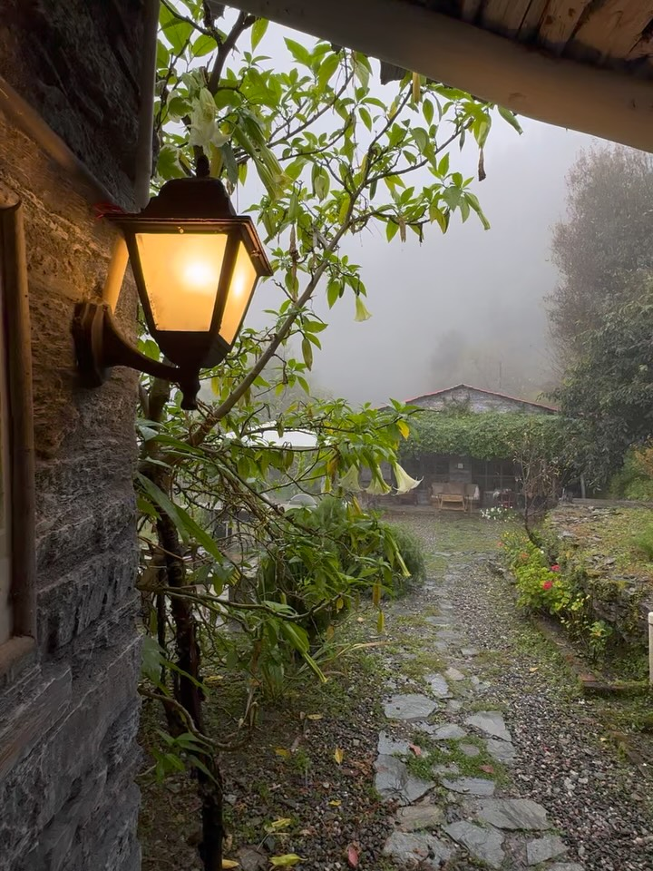
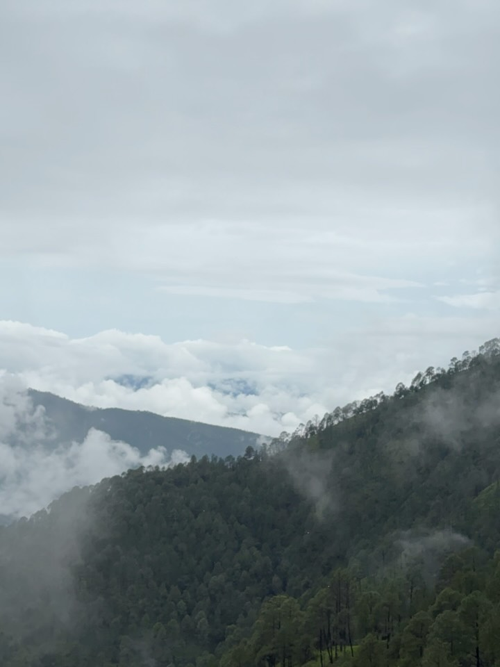

It's monsoon… so yes, it's supposed to rain. And honestly, that's the beauty of this season here in Kumaon.

But we often hear people say, "Oh no, bad weather" the moment it starts to drizzle. Maybe it's because rain, especially in cities, usually means waterlogging, traffic jams, and disrupted commutes.

But up here in the mountains of Kumaon, it's a different story. When it rains, it feels like the forest is just breathing deeper. The roads stay clear, no waterlogging, less traffic, and everything around turns lush and green, with breathtaking sunsets.

Yes, now and then, you might come across patches where loose mud or stones have slipped onto the road. But there are always JCBs around, clearing things up quickly. So if you're wondering whether it's safe to travel to Kumaon, the answer is, absolutely yes. And it's actually one of the most beautiful times to be here.

It is best to check with us before your travel dates. Call or message us and we'll tell you about the road conditions and weather.
