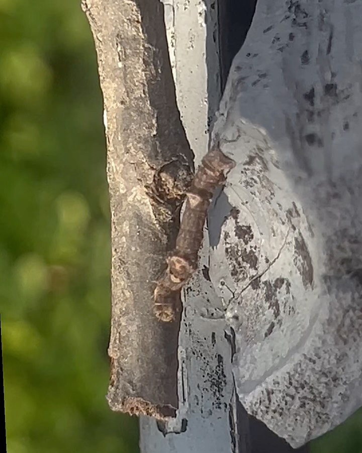
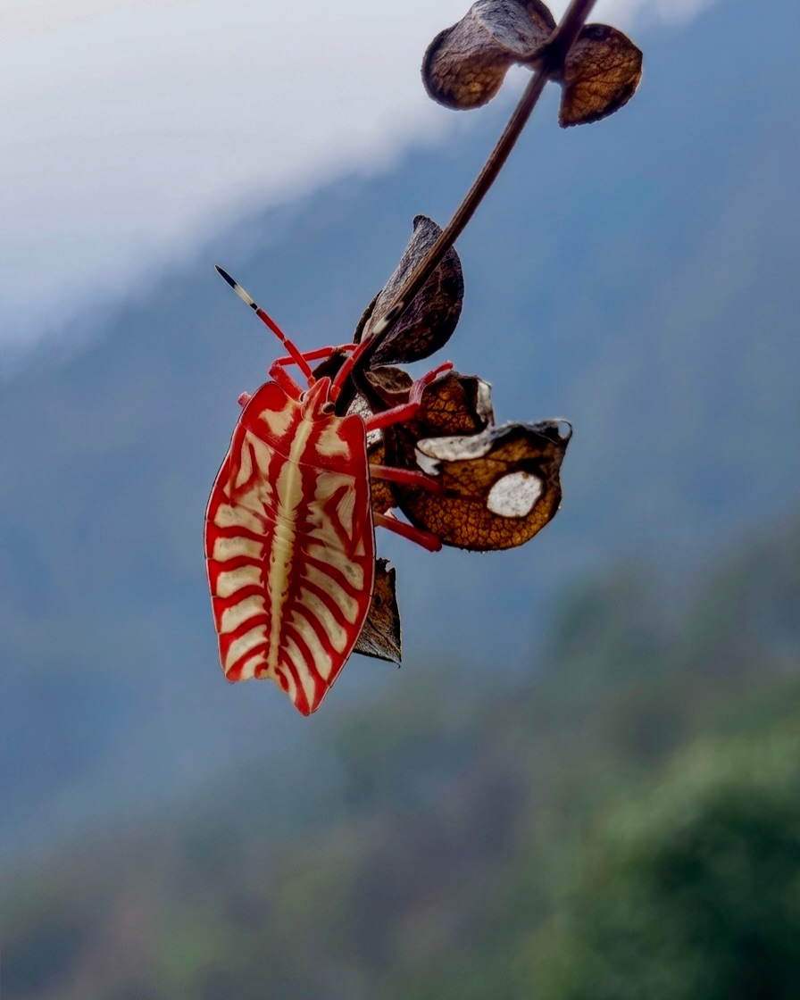
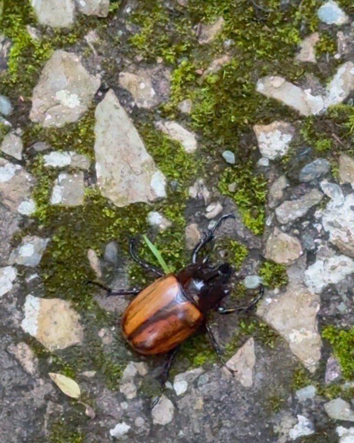

Little things… insects, objects, colours, textures. Nature.

- A twig-mimicking caterpillar. Exactly like a twig. You cannot make it out unless it moves. Incredible!
- A giant shield bug nymph (Tessaratomidae)
- A beetle with a wooden texture
- Tree rings that look like fingerprints

