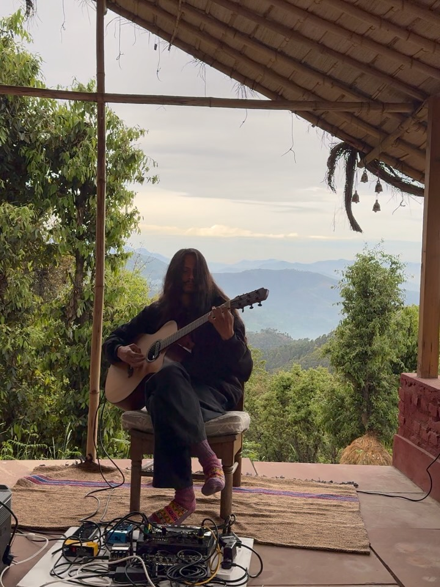
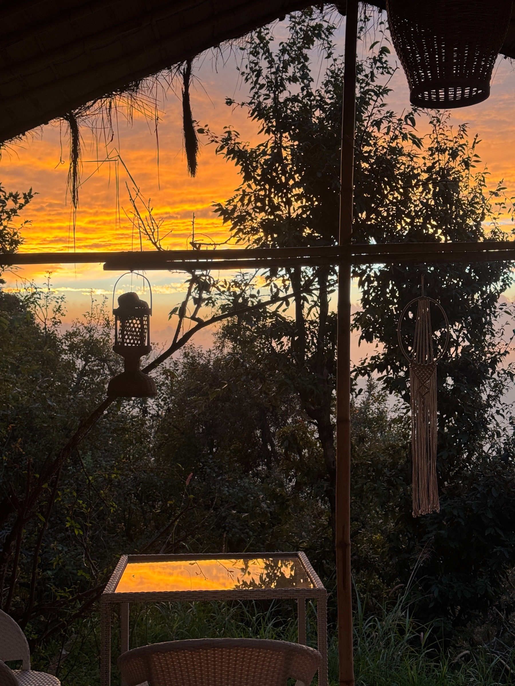
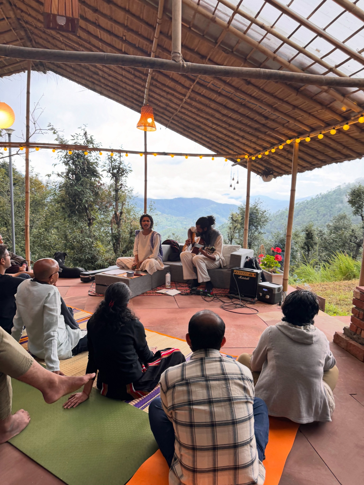
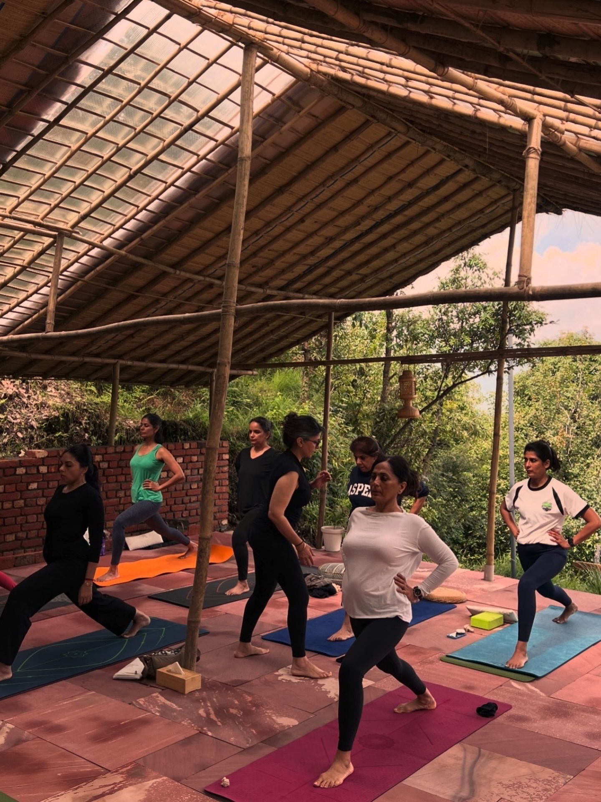

Turiya. A space at Aikkya.

It takes its name from the fourth state of consciousness, beyond waking, dreaming and deep sleep.

Here at Aikkya, we hold that thought gently, in a space for doing things, and for doing nothing at all. We gather for music, art, some form of meditation, or a conversation that wanders well beyond where it began. Sometimes we simply sit, alone or together, looking at the sunset or hearing the sound of silence.

An afternoon passes, and perhaps there is very little to say about what we did. Yet it feels like time well spent.

So much of our day is given to making something happen. We rarely leave ourselves the time to discover what holds our attention when nothing is asked of us. At Turiya, we hope there is room for that. To listen a little longer, to follow a thought, to make something without wondering whether it is any good. To let an hour be an hour, without needing to account for it.

We would like this to be a space where we give one another the ease of being ourselves. You can join a conversation, sit quietly at its edge, sing, listen, or keep your own company. Being together need not mean being alike. There is a quiet warmth in feeling welcome among people who leave you room to be.

We are happy to leave some of what Turiya might become undecided. The people who come, the moments they share, and the ordinary days in between will all have a part in it. For now, there is a place to sit, a little time, and the possibility of finding that, for this moment, it is enough.

Have you spent some time at Turiya?
